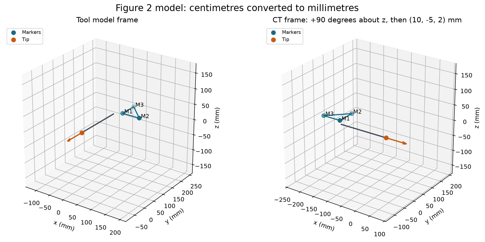
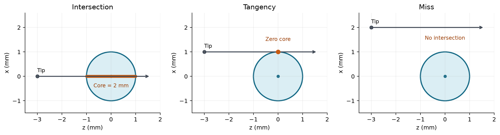

# CT-guided Bone Biopsy Planning

CISC/CMPE 330 Assignment 2: calibration, registration, geometric planning, and
targeting-error analysis for a tracked biopsy needle.

## Project components

| Component | Purpose | Repository status |
| --- | --- | --- |
| Tool calibration | Recover the tip by pivoting and the axis by spinning; validate exact and noisy marker observations. | Implemented and tested; 500-trial noise experiment included. |
| Registration | Recover the tool-to-CT rigid transformation and transform the tip and axis. | Implemented and tested. |
| Biopsy planning | Compute targeting error, available tissue-core length, and insertion depth for a spherical tumor. | Implemented and tested. |
| Targeting-error simulation | Propagate marker-localization and target-displacement errors and estimate tolerable target uncertainty. | Separate team contribution; not included in this version. |

```text
Calibration -> tool-frame tip and axis
                            |
Tool markers + CT markers -> Registration -> CT tip and axis -> Biopsy plan
                                   |
                 Noisy markers -> repeated registration -> targeting-error analysis
```

## Confirmed units and geometry

**Figure 2 coordinates are in centimetres**.
The implementation uses **millimetres** throughout, so `assignment_tool_model()`
converts the Figure 2 positions by multiplying by 10:

| Point | Figure 2 (cm) | Model returned by the code (mm) |
| --- | --- | --- |
| M1 | (2, 18, 0) | (20, 180, 0) |
| M2 | (8, 18, 0) | (80, 180, 0) |
| M3 | (2, 24, 0) | (20, 240, 0) |
| Tip | (0, 0, 0) | (0, 0, 0) |

The insertion direction remains **(0, -1, 0)**: direction vectors are
dimensionless and are not multiplied by 10. The keyword
`mm_per_figure_unit=10.0` remains supported and is now the default. Other
conversion values are only for custom synthetic experiments, not this assignment.

- Marker arrays have shape `(N, 3)`, with matching M1, M2, M3 row order in both
  frames. Registration does not infer correspondences or fit a scale factor.
- Tip and direction inputs have shape `(3,)`; directions are normalized.
- The transform maps tool/source to CT/destination:
  `point_ct = R @ point_tool + t` and `axis_ct = R @ axis_tool`.
- **Figure 6 targeting error** is the perpendicular distance from the displaced
  target to the actual needle axis. It is not the distance to the needle tip
  after a fixed 100 mm insertion.
- **Full-core insertion depth** is measured forward from the current needle tip
  to the far tumor boundary. Reaching the near boundary only starts the sample;
  reaching the center does not traverse the full available core.
- Tangency gives zero core and a finite contact depth. A miss or a target wholly
  behind the tip gives zero core and `None` for insertion depth.
- A tip already inside the sphere counts only the tissue remaining ahead.

For unit axis `u`, tip `P`, tumor center `C`, and radius `r`, set
`a = dot(C-P, u)` and `d = norm(cross(C-P, u))`. The targeting error is `d`.
If the line intersects the sphere, its signed intersection distances are
`a - sqrt(r*r-d*d)` and `a + sqrt(r*r-d*d)`. For an outside tip with both
intersections ahead, core length is `2*sqrt(r*r-d*d)` and insertion depth is
the far intersection distance.

## Run the implementation

Use Python 3.10 or newer. From the repository root:

```console
python -m pip install -r requirements.txt
python -m unittest discover -s tests -v
python -m examples.run_required_cases
python -m examples.run_calibration
```

The tests cover calibration, registration, model units, sphere geometry, invalid
inputs, and the combined pipeline. `run_required_cases` checks the six required
registration/planning cases and the Figure 6 metric. `run_calibration` checks
exact recovery and repeats noisy calibration 500 times using 60 pivot and 60
spin observations per trial.

## Tool calibration

Calibration uses two constrained movements and the existing registration function:

1. **Pivot:** hold the tip fixed while tilting about several axes. Recover each
   pose and solve `R_i * tip + t_i = pivot` for the unknown tip and pivot point.
2. **Spin:** rotate the shaft inside a fixed sleeve without tilting or sliding.
   Fit the planes of the marker circles, combine their normals, and rotate the
   resulting axis into the model frame. The calibrated tip resolves which sign
   points toward insertion; the marker cluster must lie behind the tip.

The solvers receive marker coordinates, not the true tip or axis. Simulated
Gaussian marker noise has **0.357719874 mm standard deviation per coordinate**,
which gives the required 95% probability of a 3D marker error below 1 mm.

Exact recovery is within numerical precision. Across 500 trials with seed 2026,
the 95th-percentile tip error is **0.797692 mm** and axis error is **0.124624
degrees**. These are observed calibration errors, not clinical accuracy limits.

See [the calibration method and results](docs/calibration-methods-and-results.md)
for motion constraints, equations, error statistics, and integration instructions.
The [recorded results](docs/calibration-results.json) include all trial errors.

```python
from bone_biopsy import assignment_tool_model, calibrate_tool, register_tool

model = assignment_tool_model()
# Each observed sequence has shape (poses, markers, 3), with positions in mm.
calibrated = calibrate_tool(model.markers, pivot_observations, spin_observations)
tool = register_tool(model.markers, ct_markers, calibrated.tip, calibrated.axis)
```

To reproduce the saved results and optional figures:

```console
python -m pip install -r requirements-plots.txt
python -m examples.run_calibration --trials 500 --poses 60 --seed 2026 --output docs/calibration-results.json --plot-dir docs
```

Matplotlib is needed only for figures; the main calculation and tests still use
NumPy only. Existing registration and planning examples can be run separately.

## Example

```python
from bone_biopsy import assignment_tool_model, register_tool, plan_biopsy

# Convert the Figure 2 centimetres to millimetres using the confirmed default.
model = assignment_tool_model()
ct_markers = model.markers + [10.0, -5.0, 2.0]

# Register matching marker observations and transform the tip and direction.
tool = register_tool(model.markers, ct_markers, model.tip, model.axis)

# Place a radius-5 mm tumor 100 mm ahead of the registered tip.
plan = plan_biopsy(tool.tip, tool.axis, [10.0, -105.0, 2.0], 5.0)
print(plan.targeting_error, plan.tissue_core_length, plan.insertion_depth)
# Approximately: 0.0, 10.0, 105.0 mm
```

## Analytic validation

Registration uses translation `(10, -5, 2)` mm and a +90 degree rotation about
z, which maps `(x,y,z)` to `(-y,x,z)`. Expected CT marker coordinates are
calculated independently from the corrected model:

| Case | CT markers M1; M2; M3 (mm) | Expected tip (mm) | Expected axis |
| --- | --- | --- | --- |
| Translation | (30,175,2); (90,175,2); (30,235,2) | (10,-5,2) | (0,-1,0) |
| Rotation | (-180,20,0); (-180,80,0); (-240,20,0) | (0,0,0) | (1,0,0) |
| Rotation + translation | (-170,15,2); (-170,75,2); (-230,15,2) | (10,-5,2) | (1,0,0) |

Planning uses an independent unit sphere at `(0,0,0)` with radius 1 mm and
direction `(0,0,1)`. These already-mm test inputs do not need conversion.

| Case | Tip (mm) | Targeting error (mm) | Core length (mm) | Insertion/contact depth (mm) |
| --- | --- | --- | --- | --- |
| Intersection | (0,0,-3) | 0 | 2 | 4 |
| Tangency | (1,0,-3) | 1 | 0 | 3 |
| Miss | (2,0,-3) | 2 | 0 | None |

The combined case uses the rotated and translated tool, tumor center
`(110,-2,2)` mm, and radius 5 mm. Expected error, entry depth, core length,
and insertion depth are **3, 96, 8, and 104 mm**.

For a Figure 6 metric check, the planned target is `(0,-100,0)` mm, the actual
tip is `(3,0,0)` mm, the axis is `(0,-1,0)`, and the displaced target is
`(0,-104,0)` mm. The perpendicular targeting error is **3 mm**. The needle
endpoint after 100 mm insertion is 5 mm from the displaced target; that
endpoint distance is not the Figure 6 targeting error.

## Team integration

- Replace the ground-truth tip and axis with calibrated values in the same
  model frame as the markers. Convert a calibrated tip from cm to mm once if
  necessary; do not scale its direction.
- Existing assignment callers using `mm_per_figure_unit=1` must switch to
  `assignment_tool_model()` or `mm_per_figure_unit=10`.
- CT observations, tumor coordinates, radii, translations, and noise must use
  mm. Do not multiply values already supplied in mm by 10: the 100 mm target
  depth, 3 mm targeting threshold, and 1 mm localization bound stay unchanged.
- For Figure 6, the nominal target is `(0,-100,0)` mm in the illustrated CT
  frame. Add target displacement to this location and measure its perpendicular
  distance to the actual needle axis obtained from the simulated registration.
- Re-run any calibration or uncertainty experiments that used the old tool
  scale. Their results cannot be corrected by multiplying the final error by 10.
- `rms_residual` measures fit at the markers; it is not the targeting error.

## Public functions

| Function | Result |
| --- | --- |
| `assignment_tool_model(mm_per_figure_unit=10.0)` | `ToolModel` with mm `markers`, mm `tip`, and dimensionless `axis` |
| `calibrate_tip(model_markers, pivot_observations)` | Model-frame tip, tracker-frame pivot, residual, and conditioning |
| `calibrate_axis(model_markers, spin_observations, calibrated_tip=...)` | Model-frame insertion axis and spin diagnostics |
| `calibrate_tool(model_markers, pivot_observations, spin_observations)` | Calibrated tip and axis for `register_tool` |
| `simulate_pivot_motion(model, ...)`, `simulate_spin_motion(model, ...)` | Simulated observations and true poses for validation |
| `sigma_for_radial_bound(bound_mm=1, probability=0.95)` | Per-coordinate sigma for the specified 3D radial bound |
| `add_marker_noise(observations, sigma_mm, rng=...)` | Independent noisy marker observations |
| `register_rigid(source_markers, destination_markers)` | Rotation, translation, and RMS marker-fit residual |
| `register_tool(model_markers, ct_markers, tip_tool, axis_tool)` | Registered CT tip, axis, and transform |
| `distance_point_to_line(point, line_point, direction)` | Perpendicular distance to the infinite axis |
| `intersect_line_sphere(line_point, direction, center, radius)` | Ordered signed intersection distances, or `None` |
| `plan_biopsy(tip, direction, tumor_center, tumor_radius)` | Status, targeting error, core length, and insertion/entry/exit depths |

## View the solution





## References

- *CT-guided Bone Biopsy Planning*, CISC/CMPE 330 Assignment 2: Figure 2 for
  the tool geometry, Figure 6 for targeting error, and the registration and
  planning requirements and rubric.
- Professor Fichtinger's clarification: Figure 2 coordinate units are cm;
  insertion reaches the far tumor boundary for the full core; use Figure 6
  to interpret targeting error.
- *MathPrimer-Part3*: coordinate transformations and registration errors.
- *Calibration*, slides 5-7 and 11: pivot least squares and spin-plane axis calibration.

The implementation uses the assignment's straight needle and spherical tumor
geometry. The target-displacement uncertainty sweep remains a separate team component.
