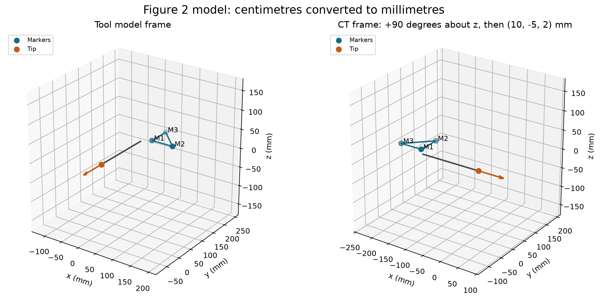
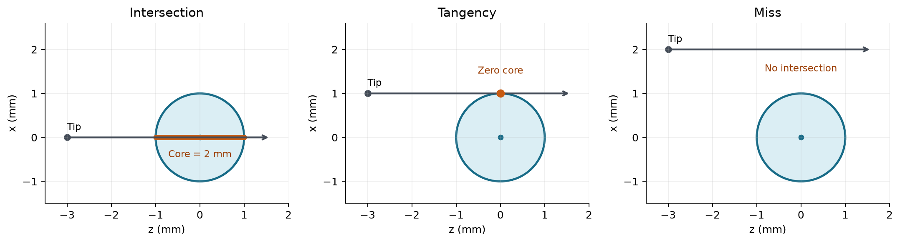

# CT-guided Bone Biopsy Planning

CISC/CMPE 330 Assignment 2: calibration, registration, geometric planning, and
targeting-error analysis for a tracked biopsy needle.

## Project components

| Component | Purpose | Repository status |
| --- | --- | --- |
| Tool calibration | Estimate the tool-frame tip and axis from constrained tracked movements; evaluate exact and noisy observations. | Separate team contribution; not included in this version. |
| Registration | Recover the tool-to-CT rigid transformation and transform the tip and axis. | Implemented and tested. |
| Biopsy planning | Compute targeting error, available tissue-core length, and insertion depth for a spherical tumor. | Implemented and tested. |
| Targeting-error simulation | Propagate marker-localization and target-displacement errors and estimate tolerable target uncertainty.|

```text
Calibration -> tool-frame tip and axis
                            |
Tool markers + CT markers -> Registration -> CT tip and axis -> Biopsy plan
                                   |
                 Noisy markers -> repeated registration -> targeting-error analysis
```

## Confirmed units and geometry

**Figure 2 coordinates are in centimetres**.
The implementation uses **millimetres** throughout, so `assignment_tool_model()`
converts the Figure 2 positions by multiplying by 10:

| Point | Figure 2 (cm) | Model returned by the code (mm) |
| --- | --- | --- |
| M1 | (2, 18, 0) | (20, 180, 0) |
| M2 | (8, 18, 0) | (80, 180, 0) |
| M3 | (2, 24, 0) | (20, 240, 0) |
| Tip | (0, 0, 0) | (0, 0, 0) |

The insertion direction remains **(0, -1, 0)**: direction vectors are
dimensionless and are not multiplied by 10. The keyword
`mm_per_figure_unit=10.0` remains supported and is now the default. Other
conversion values are only for custom synthetic experiments, not this assignment.

- Marker arrays have shape `(N, 3)`, with matching M1, M2, M3 row order in both
  frames. Registration does not infer correspondences or fit a scale factor.
- Tip and direction inputs have shape `(3,)`; directions are normalized.
- The transform maps tool/source to CT/destination:
  `point_ct = R @ point_tool + t` and `axis_ct = R @ axis_tool`.
- **Figure 6 targeting error** is the perpendicular distance from the displaced
  target to the actual needle axis. It is not the distance to the needle tip
  after a fixed 100 mm insertion.
- **Full-core insertion depth** is measured forward from the current needle tip
  to the far tumor boundary. Reaching the near boundary only starts the sample;
  reaching the center does not traverse the full available core.
- Tangency gives zero core and a finite contact depth. A miss or a target wholly
  behind the tip gives zero core and `None` for insertion depth.
- A tip already inside the sphere counts only the tissue remaining ahead.

For unit axis `u`, tip `P`, tumor center `C`, and radius `r`, set
`a = dot(C-P, u)` and `d = norm(cross(C-P, u))`. The targeting error is `d`.
If the line intersects the sphere, its signed intersection distances are
`a - sqrt(r*r-d*d)` and `a + sqrt(r*r-d*d)`. For an outside tip with both
intersections ahead, core length is `2*sqrt(r*r-d*d)` and insertion depth is
the far intersection distance.

## Run the implementation

Use Python 3.10 or newer. From the repository root:

```console
python -m pip install -r requirements.txt
python -m unittest discover -s tests -v
python -m examples.run_required_cases
```

The 41 tests cover registration, model units, sphere geometry, invalid inputs,
and the combined pipeline. The example runner checks the six required cases,
a combined case, and the distinction between Figure 6 error and endpoint error.

## Example

```python
from bone_biopsy import assignment_tool_model, register_tool, plan_biopsy

# Convert the Figure 2 centimetres to millimetres using the confirmed default.
model = assignment_tool_model()
ct_markers = model.markers + [10.0, -5.0, 2.0]

# Register matching marker observations and transform the tip and direction.
tool = register_tool(model.markers, ct_markers, model.tip, model.axis)

# Place a radius-5 mm tumor 100 mm ahead of the registered tip.
plan = plan_biopsy(tool.tip, tool.axis, [10.0, -105.0, 2.0], 5.0)
print(plan.targeting_error, plan.tissue_core_length, plan.insertion_depth)
# Approximately: 0.0, 10.0, 105.0 mm
```

## Analytic validation

Registration uses translation `(10, -5, 2)` mm and a +90 degree rotation about
z, which maps `(x,y,z)` to `(-y,x,z)`. Expected CT marker coordinates are
calculated independently from the corrected model:

| Case | CT markers M1; M2; M3 (mm) | Expected tip (mm) | Expected axis |
| --- | --- | --- | --- |
| Translation | (30,175,2); (90,175,2); (30,235,2) | (10,-5,2) | (0,-1,0) |
| Rotation | (-180,20,0); (-180,80,0); (-240,20,0) | (0,0,0) | (1,0,0) |
| Rotation + translation | (-170,15,2); (-170,75,2); (-230,15,2) | (10,-5,2) | (1,0,0) |

Planning uses an independent unit sphere at `(0,0,0)` with radius 1 mm and
direction `(0,0,1)`. These already-mm test inputs do not need conversion.

| Case | Tip (mm) | Targeting error (mm) | Core length (mm) | Insertion/contact depth (mm) |
| --- | --- | --- | --- | --- |
| Intersection | (0,0,-3) | 0 | 2 | 4 |
| Tangency | (1,0,-3) | 1 | 0 | 3 |
| Miss | (2,0,-3) | 2 | 0 | None |

The combined case uses the rotated and translated tool, tumor center
`(110,-2,2)` mm, and radius 5 mm. Expected error, entry depth, core length,
and insertion depth are **3, 96, 8, and 104 mm**.

For a Figure 6 metric check, the planned target is `(0,-100,0)` mm, the actual
tip is `(3,0,0)` mm, the axis is `(0,-1,0)`, and the displaced target is
`(0,-104,0)` mm. The perpendicular targeting error is **3 mm**. The needle
endpoint after 100 mm insertion is 5 mm from the displaced target; that
endpoint distance is not the Figure 6 targeting error.

## Team integration

- Replace the ground-truth tip and axis with calibrated values in the same
  model frame as the markers. Convert a calibrated tip from cm to mm once if
  necessary; do not scale its direction.
- Existing assignment callers using `mm_per_figure_unit=1` must switch to
  `assignment_tool_model()` or `mm_per_figure_unit=10`.
- CT observations, tumor coordinates, radii, translations, and noise must use
  mm. Do not multiply values already supplied in mm by 10: the 100 mm target
  depth, 3 mm targeting threshold, and 1 mm localization bound stay unchanged.
- For Figure 6, the nominal target is `(0,-100,0)` mm in the illustrated CT
  frame. Add target displacement to this location and measure its perpendicular
  distance to the actual needle axis obtained from the simulated registration.
- Re-run any calibration or uncertainty experiments that used the old tool
  scale. Their results cannot be corrected by multiplying the final error by 10.
- `rms_residual` measures fit at the markers; it is not the targeting error.

## Public functions

| Function | Result |
| --- | --- |
| `assignment_tool_model(mm_per_figure_unit=10.0)` | `ToolModel` with mm `markers`, mm `tip`, and dimensionless `axis` |
| `register_rigid(source_markers, destination_markers)` | Rotation, translation, and RMS marker-fit residual |
| `register_tool(model_markers, ct_markers, tip_tool, axis_tool)` | Registered CT tip, axis, and transform |
| `distance_point_to_line(point, line_point, direction)` | Perpendicular distance to the infinite axis |
| `intersect_line_sphere(line_point, direction, center, radius)` | Ordered signed intersection distances, or `None` |
| `plan_biopsy(tip, direction, tumor_center, tumor_radius)` | Status, targeting error, core length, and insertion/entry/exit depths |

## View the solution





## References

- *CT-guided Bone Biopsy Planning*, CISC/CMPE 330 Assignment 2: Figure 2 for
  the tool geometry, Figure 6 for targeting error, and the registration and
  planning requirements and rubric.
- Professor Fichtinger's clarification: Figure 2 coordinate units are cm;
  insertion reaches the far tumor boundary for the full core; use Figure 6
  to interpret targeting error.
- *MathPrimer-Part3*: coordinate transformations and registration errors.

The implementation uses the assignment's straight needle and spherical tumor
geometry
