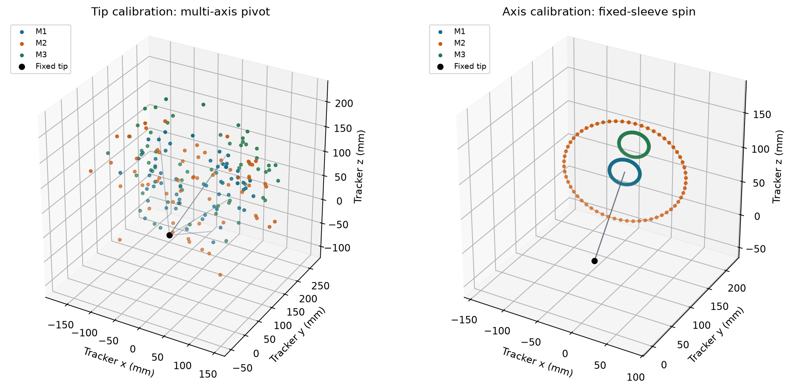
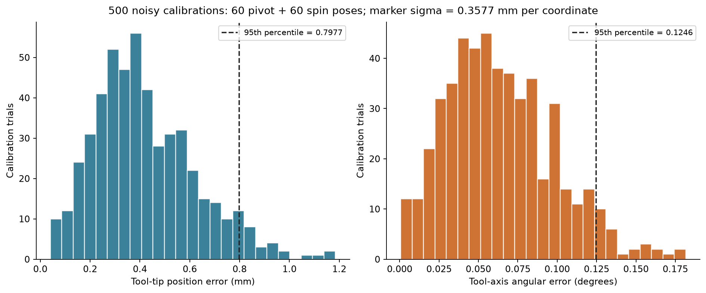

# Tool calibration: method and validation

This component estimates the tip position and insertion direction in the
marker-defined tool frame from simulated optical-tracker measurements. It uses
the existing `register_rigid` function for every observed pose. The output can
be passed directly to `register_tool` and then `plan_biopsy`.

## 1. Shared model and inputs

Figure 2 coordinates are in cm. `assignment_tool_model()` converts them to mm:

| Quantity | Ground truth in the model frame |
| --- | --- |
| M1 | (20, 180, 0) mm |
| M2 | (80, 180, 0) mm |
| M3 | (20, 240, 0) mm |
| Tip | (0, 0, 0) mm |
| Insertion direction | (0, -1, 0), dimensionless |

The calibration solver receives the model markers and two arrays of tracker
observations, each shaped `(number_of_poses, number_of_markers, 3)`. Marker row
order must remain M1, M2, M3 in every frame. All positions use mm.

**The true tip and axis are used only to generate observations and calculate
validation errors. They are not passed to the calibration solver.** The axis
solver receives the tip estimated by the pivot solver to resolve direction sign.

## 2. Tool-tip calibration by pivoting

**Motion constraint:** hold the tip fixed in a dimple and tilt the tool about
multiple axes, with widely spread orientations. Do not let the tip slip. Merely
spinning about the shaft leaves part of the tip position unobservable.

1. Recover each model-to-tracker pose `(R_i, t_i)` from corresponding markers
   using rigid registration.
2. Let `p` be the unknown tip in the model frame and `q` the unknown fixed pivot
   in the tracker frame. Each pose satisfies:

   `R_i p + t_i = q`.

3. Stack the equations as `[R_i, -I] [p; q] = -t_i` and solve the overdetermined
   system with `numpy.linalg.lstsq`.
4. Require rank six so all six unknown coordinates are determined. Report the
   condition number to indicate sensitivity to weakly spread orientations.
5. Report `sqrt(mean(||R_i p + t_i - q||^2))` as the pivot residual in mm.

The residual describes agreement with the fixed-pivot constraint. It does not
equal the true tip-position error and does not prove that the tip never slipped.

## 3. Tool-axis calibration by spinning

**Motion constraint:** place the shaft inside a stationary guide sleeve and
rotate through a broad arc, preferably a full turn. Keep the shaft line fixed,
with no tilt or axial sliding. The fixed shaft makes each off-axis marker trace
a planar circle. For the assignment model, circle radii are 20, 80, and 20 mm.

1. For each marker, center its tracker-space observations and fit a plane by SVD.
   The right singular vector with the smallest singular value is its normal.
2. Ignore a marker that provides no resolved plane. A marker exactly on the
   shaft has no circular motion and cannot determine a normal.
3. Align the arbitrary signs of the normals. Average them with weights
   `s_1^2 + s_2^2`, the observed in-plane spread, so wider circles contribute
   more strongly. Normalize the result to obtain the tracker-frame axis.
4. For every recovered pose, rotate the tracker axis into the model frame with
   `R_i.T @ axis_tracker`. Average these vectors and normalize again.
5. A plane normal still has a `+/-` ambiguity. The marker cluster is physically
   behind the needle tip, so orient the axis toward the calibrated tip from
   the mean model marker position. This supplies the insertion-facing sign
   without looking up the true axis.

**Sign assumption:** the marker centroid must lie behind the tip along the
shaft. If a different tool places markers beyond the tip or at the same axial
level, this sign convention is not applicable. The solver rejects an ambiguous
zero axial separation.

The implementation uses simple acquisition checks: a plane's smallest-to-middle
singular-value ratio must be at most 0.25; accepted normals must be within 10
degrees of their combined direction; and transformed model-frame directions
must be within 10 degrees of their mean. These are loose motion-quality checks,
not clinical accuracy requirements. They do not guarantee detection of every
constraint violation. Plane residuals and direction scatter are also returned.

## 4. Simulated observations

The reference experiment uses **60 pivot poses and 60 spin poses**. Pivot tilts
are sampled within a cone of 40 degrees half-angle, with varying azimuth and
shaft roll. This allows an 80-degree total angular span. Spin poses uniformly
sample a full 360-degree revolution without duplicating the initial pose.

The tracker frame is deliberately rotated by 0.4 radians about `(1,2,3)` and
the fixed tip is placed at `(25,-10,40)` mm. Calibration therefore cannot rely
on the tracker and model frames being identical.

For each true rotation, the simulator sets

`t_i = fixed_tip_tracker - R_i @ true_tip_model`

and generates each marker as

`marker_tracker = R_i @ marker_model + t_i`.

Only the generated marker coordinates reach the solver. True poses remain
available for tests and illustrations. The pivot-motion random seed is 17.



## 5. Gaussian noise level

For each frame and marker, add an independent error
`e = (e_x, e_y, e_z)`, where each coordinate follows `N(0, sigma^2)`.
The assignment requires `P(||e|| < 1 mm) = 0.95` for the **3D length**.

Because `||e||^2 / sigma^2` follows a chi-square distribution with three degrees
of freedom,

`sigma = 1 / sqrt(chi_square_3_quantile(0.95)) = 0.357719874 mm`.

The reusable noise utility computes this value by inverting the equivalent
3D radial CDF with bisection, using only the standard library. Neither a 1D
`1/1.96` conversion nor sigma = 1 mm satisfies the stated 3D requirement.
Gaussian errors are not clipped: approximately 5% should exceed 1 mm.

**Noise is added to the marker observations before registration.** Each noisy
frame is registered again, then both calibration problems are solved again.
The pivot and spin sequences receive independent draws.

## 6. Exact and noisy results

Reproduce the reference experiment from the repository root:

```console
python -m examples.run_calibration --trials 500 --poses 60 --seed 2026 --output docs/calibration-results.json
```

The exact-data solution recovered the tip with **2.28e-14 mm** position error
and the axis with **1.45e-15 degrees** angular error. These are numerical
roundoff. Tests also recover a nonzero tip and an oblique axis in a different
model frame, and solve a separate hand-constructed pivot example.

For the first noisy trial:

- Estimated tip: `(0.097520, 0.119744, -0.023508)` mm.
- Estimated axis: `(0.00006283, -0.99999928, -0.00120043)`.
- Tip-position error: **0.156209 mm**.
- Axis-direction error: **0.068874 degrees**.

Across 500 independent noisy calibrations:

| Error magnitude | Mean | Median | RMS | 95th percentile | Maximum |
| --- | ---: | ---: | ---: | ---: | ---: |
| Tip-position error (mm) | 0.419917 | 0.390112 | 0.465978 | 0.797692 | 1.184480 |
| Axis-direction error (degrees) | 0.064259 | 0.059526 | 0.072717 | 0.124624 | 0.181567 |

Tip error is `||estimated_tip - true_tip||`. Axis error is the angle between
the two signed unit directions, calculated with `atan2` of cross-product
length and dot product. Reversed directions give 180 degrees, not zero.

Among the **180,000 marker observations** used in these trials, **95.0439%** had
error below 1 mm. The expected binomial standard error is about **0.0514
percentage points**, so this is consistent with the intended 95% noise bound.



The complete configuration, first-trial values, summary statistics, and all
500 error pairs are stored in [the results file](calibration-results.json).
Small last-digit differences can occur across numerical-library versions.

## 7. Interpretation and limitations

- Exact recovery validates the geometric method and coordinate transformations.
  The additional nonzero-tip test prevents a constant `(0,0,0)` answer from
  appearing to be a successful calibration.
- Noise at the markers affects both fitted rotation and translation. The tip
  is roughly 180-240 mm from the markers, so small pose-angle errors can cause
  noticeable extrapolation error at the tip.
- Multiple poses average measurement fluctuations. Broad pivot angles provide
  a stronger linear system; broad spin arcs provide better-defined circle
  planes. Larger marker-circle radii help determine the spin normal.
- The marker 95% bound does not impose a 1 mm upper bound on calibration error.
  These Gaussian draws are unbounded, and the observed maximum tip error was
  1.184480 mm. The reported 95th percentiles are empirical quantiles, not
  confidence intervals or guaranteed error limits.
- These 500 trials use the same fixed motion design with independent noise.
  Results characterize that design and the stated noise model. They do not
  include motion-constraint violations, imperfect model marker positions,
  correlated tracker error, or mechanical bending.
- This experiment concerns calibration. The target-displacement sigma sweep
  and the 100 mm / 3 mm targeting requirement remain a separate project part.

## 8. Integration, files, and checks

```python
from bone_biopsy import calibrate_tool, register_tool, plan_biopsy

# Calibrate from measured marker sequences in the shared model frame.
calibrated = calibrate_tool(model_markers, pivot_observations, spin_observations)

# Register the calibrated tip and direction to a new CT observation.
tool = register_tool(model_markers, ct_markers, calibrated.tip, calibrated.axis)
plan = plan_biopsy(tool.tip, tool.axis, tumor_center, tumor_radius)
```

The exact integrated example gives targeting error **3 mm**, entry depth
**96 mm**, core length **8 mm**, and full-core insertion depth **104 mm**.

| File | Purpose |
| --- | --- |
| `bone_biopsy/calibration.py` | Tip and axis solvers, validation, fit diagnostics |
| `bone_biopsy/calibration_simulation.py` | Constrained ground-truth motion generation |
| `bone_biopsy/geometry.py` | Axis-angle rotation, plane fitting, angular error |
| `bone_biopsy/noise.py` | 3D radial noise conversion and marker perturbation |
| `examples/run_calibration.py` | Exact validation, 500-trial experiment, JSON export |
| `examples/plot_calibration.py` | Optional motion and error-distribution figures |
| `tests/test_calibration.py` | Geometry, noise, motion, calibration, and integration checks |

Run all project tests with `python -m unittest discover -s tests -v`.
To regenerate figures, first install `requirements-plots.txt`, then add
`--plot-dir docs` to the experiment command. Matplotlib is optional; the
calibration, simulations, and tests require NumPy only.

## References

- *CT-guided Bone Biopsy Planning*, CISC/CMPE 330 Assignment 2, pages 1-2 and
  the tool-calibration rubric: tip/axis calibration, exact simulation, and
  noisy-marker validation.
- Gabor Fichtinger, *Calibration* (2026), slides 5-7: tracked three-marker
  tool and least-squares pivot formulation; slide 11: spin-axis calibration
  from marker-circle plane normals.
- Professor Fichtinger's clarification: Figure 2 positions are in centimetres.
