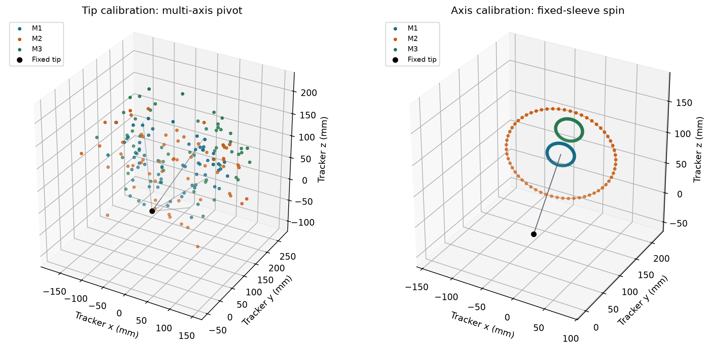
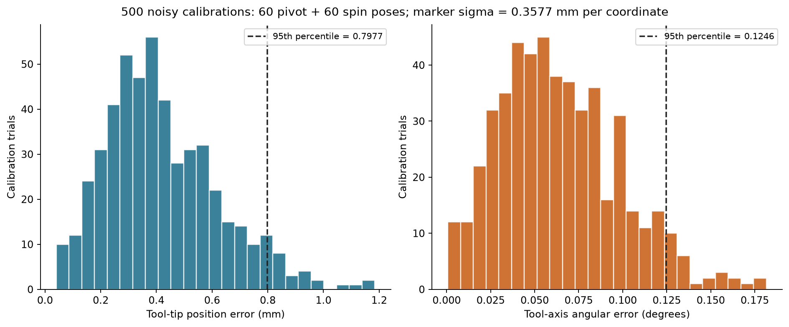
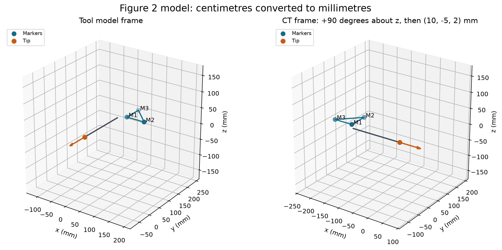
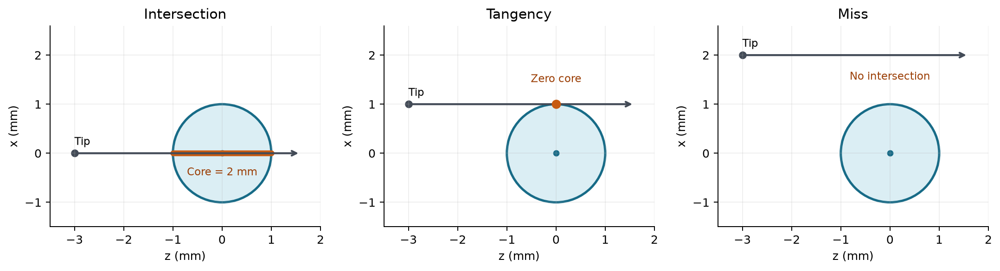

# A2: Bone Biopsy Planning

## 1. What this part of the project does

This report covers tool calibration, registration, and biopsy planning. The
main idea is to find the needle tip and direction, express them in the CT
frame, and work out how the needle would pass through a spherical tumor.

Calibration finds the tip and axis relative to the tool markers. Registration
finds where that calibrated tool is in a new CT image. Planning then uses the
registered tip and axis to calculate targeting error, tissue-core length, and
insertion depth. The separate target-displacement simulation is not included
in this part of the project.

For each required check below, the expected answer comes from the stated
geometry. The program result is then compared with that answer. The actual
console output is saved in [validation-output.txt](validation-output.txt),
and the individual noisy calibration errors are saved in
[calibration-results.json](calibration-results.json).

### Units and coordinate frames

The coordinates in assignment Figure 2 are in cm, as clarified by the
professor. The code uses mm, so each position is multiplied by 10 once.

| Quantity | Figure 2 | Value used by the code |
| --- | --- | --- |
| M1 | (2,18,0) cm | (20,180,0) mm |
| M2 | (8,18,0) cm | (80,180,0) mm |
| M3 | (2,24,0) cm | (20,240,0) mm |
| Tip | (0,0,0) cm | (0,0,0) mm |
| Insertion axis | (0,-1,0) | (0,-1,0), dimensionless |

A direction has no length unit, so it is not multiplied by 10. Values already
given in mm, such as the 100 mm target depth and the 1 mm marker-error bound,
also stay unchanged. `assignment_tool_model()` applies the cm-to-mm conversion.

There are three frames: the model frame attached to the tool, the optical
tracker frame used during calibration, and the CT frame used during planning.
Every marker array uses the order M1, M2, M3. Matching the wrong rows would
describe a different correspondence problem.

For a point, the model-to-destination transformation is `x = R p + t`. For a
direction, it is `u = R v`. Translation moves a position but cannot change the
direction of a line. The arrays store points as rows, so the equivalent code
for several points is `points @ R.T + t`.

## 2. Tool-tip calibration

### Why pivoting works

The tip is held in a fixed dimple while the handle is tilted in different
directions. The markers move, but the tip stays at the same tracker-space
position. This gives a useful constraint without needing the tracker to see
the tip directly.

Let `p` be the unknown tip in the model frame and `q` the unknown fixed pivot
in the tracker frame. Registration gives a rotation and translation for each
observed pose. Therefore every pose should satisfy

```text
R_i p + t_i = q
[R_i  -I] [p; q] = -t_i.
```

There are six unknown coordinates: three in `p` and three in `q`. The code
stacks these equations and solves them using least squares. With noisy
measurements the equations do not agree exactly, so least squares finds the
solution with the smallest sum of squared residuals.

The orientations must vary about more than one axis. Repeating the same pose
adds no new geometric information. Only spinning around the shaft also leaves
an ambiguity along the shaft. The code checks that the stacked system has rank
six. Its condition number indicates how sensitive the solution is to small
changes in the observations.

### A small pivot example worked out by hand

The assignment's true tip is zero, so an extra nonzero-tip example is useful:
it checks that the method actually solves for the tip instead of always
returning `(0,0,0)`.

For this test only, choose the true model-frame tip as `p=(1,2,3)` mm and the
fixed tracker pivot as `q=(10,20,30)` mm. Use the original model markers and
four simple rotations. From `t=q-Rp`, the translations must be:

| Pose | Coordinate rule for R | R p | t = q - R p (mm) |
| --- | --- | --- | --- |
| Identity | (x,y,z) | (1,2,3) | (9,18,27) |
| +90 degrees about x | (x,-z,y) | (1,-3,2) | (9,23,28) |
| +90 degrees about y | (z,y,-x) | (3,2,-1) | (7,18,31) |
| +90 degrees about z | (-y,x,z) | (-2,1,3) | (12,19,27) |

These choices determine the tracker marker positions directly. For example,
in the x-rotation pose, M1 becomes `(20,0,180)+(9,23,28)=(29,23,208)` mm.

| Pose | Observed M1 (mm) | Observed M2 (mm) | Observed M3 (mm) |
| --- | --- | --- | --- |
| Identity | (29,198,27) | (89,198,27) | (29,258,27) |
| x rotation | (29,23,208) | (89,23,208) | (29,23,268) |
| y rotation | (7,198,11) | (7,198,-49) | (7,258,11) |
| z rotation | (-168,39,27) | (-168,99,27) | (-228,39,27) |

The solver receives these marker positions, not the chosen `p` and `q`.
The answer can also be recovered by comparing the equations by hand. For
the identity and x-rotation poses:

```text
Identity: q = (p_x+9,  p_y+18,  p_z+27)
x pose:   q = (p_x+9, -p_z+23,  p_y+28)

Matching y coordinates: p_y + p_z = 5
Matching z coordinates: p_z - p_y = 1
Therefore p_y = 2 and p_z = 3.
```

The y-rotation pose gives `q_x=p_z+7`. Comparing this with
`q_x=p_x+9` gives `p_x=p_z-2=1`. Substitution then gives
`q=(1+9,2+18,3+27)=(10,20,30)` mm. The fourth pose is another check:
`(-2,1,3)+(12,19,27)=(10,20,30)` mm.

**Program result:** the tip is `(1.000000,2.000000,3.000000)` mm and the
pivot is `(10.000000,20.000000,30.000000)` mm to six decimal places. The tip
difference is **6.877e-14 mm**. This agrees with the hand solution to numerical
precision. This example is printed by `examples.run_calibration`.

## 3. Tool-axis calibration

### Why spinning works

The shaft is placed in a stationary guide sleeve and spun without tilting or
sliding along the sleeve. Each off-axis marker then traces a circle. The plane
of that circle is perpendicular to the shaft, so its normal gives the shaft's
axis line.

For each marker, the code subtracts the mean of its observed positions and
fits a plane with SVD. The direction with the least variation is the plane
normal. Normal signs are aligned before averaging, because `n` and `-n`
describe the same plane. Wider circles receive more weight, using the sum of
the two in-plane squared singular values. Their larger spread makes their
normal less sensitive to the same size of marker error.

The combined normal is in the tracker frame. It is rotated back with `R_i.T`
for each observed pose, then averaged and normalized in the model frame.
No translation is applied to this direction.

There is still a sign choice. In this tool, the markers are behind the tip,
so the insertion direction should point from the marker cluster toward the
calibrated tip. This uses the tip found by pivoting, not the known true axis.
This sign rule would need changing for a tool whose markers were beyond the
tip or at the same axial level.

### A spin example worked out by hand

Take four quarter-turn poses about the y axis with the tip at the origin.
The marker coordinates are:

| Rotation about y | M1 (mm) | M2 (mm) | M3 (mm) |
| --- | --- | --- | --- |
| 0 degrees | (20,180,0) | (80,180,0) | (20,240,0) |
| 90 degrees | (0,180,-20) | (0,180,-80) | (0,240,-20) |
| 180 degrees | (-20,180,0) | (-80,180,0) | (-20,240,0) |
| 270 degrees | (0,180,20) | (0,180,80) | (0,240,20) |

For M1, y always equals 180, so all four observations lie in the plane
`y=180`. Their distances from `(0,180,0)` are all 20 mm. M2 also lies in
`y=180`, with radius 80 mm. M3 lies in `y=240`, with radius 20 mm.
All three planes have normals parallel to the y axis.

For a direct normal calculation, subtract M1's first position from its next
two positions. The vectors are `(-20,0,-20)` and `(-40,0,0)`. Their cross
product is `(0,800,0)`, which normalizes to `(0,1,0)`.

The mean model marker position is `(40,200,0)` mm. The vector from there to
the calibrated tip is approximately `(-40,-200,0)`. Its dot product with
`(0,1,0)` is -200, so the normal points away from insertion and must be
reversed. The expected insertion direction is **(0,-1,0)**.

**Program result:** `(-1.401e-16,-1,0)`, giving an angular difference of
**8.029e-15 degrees**. The tiny x component is roundoff. The recovered axis
therefore agrees with the plane geometry and the required insertion sign.

## 4. Exact and noisy calibration experiments

### Motion generation and settings

The larger experiment uses the assignment model with 60 pivot poses and 60
spin poses. Pivot tilts are sampled within a cone with a 40-degree half-angle,
with different azimuths and shaft rolls. The cone allows an 80-degree total
angular span; it does not mean every random sample reaches its boundary.
Spin poses cover a complete turn without repeating the initial pose.

The tracker frame is rotated by 0.4 radians about `(1,2,3)` and the fixed tip
is at `(25,-10,40)` mm. This checks a case where the tracker and model frames
are different. For each chosen rotation, the simulator uses

```text
t_i = fixed_tip_tracker - R_i @ true_tip_model
observed_marker = R_i @ model_marker + t_i.
```

The known tip and axis are used to create these motions and to measure errors
afterward. The calibration solver receives only the model markers and observed
marker arrays. It does not receive the true poses, tip, or axis.

| Setting | Value and reason |
| --- | --- |
| Figure 2 position scale | 10 mm per cm, from the professor's clarification |
| Pivot poses | 60, to use many different orientations |
| Pivot cone half-angle | 40 degrees, to obtain a broad range of tilts |
| Spin poses and arc | 60 poses over 360 degrees, to cover the marker circles |
| Motion seed | 17, so the same motions can be reproduced |
| Noisy calibration trials | 500, to show a distribution rather than one lucky result |
| Noise seed | 2026, so the recorded noisy results can be reproduced |
| Tracker tip position and rotation | Chosen test coordinates, not patient measurements |

The pose count, cone angle, trial count, and seeds are experimental choices.
They are not limits specified by the assignment, and this experiment does not
claim they are optimal.



The left plot shows the markers spreading out as the tool pivots around the
black tip point. The right plot shows the three circles during a fixed-axis
spin. These different patterns are the reason the two movements provide
different calibration information.

### Choosing the noise level

The assignment specifies a 95% probability that a marker's **3D position
error** is below 1 mm. Each coordinate error is independently Gaussian with
mean zero and standard deviation `sigma`. Consequently,

```text
(e_x^2 + e_y^2 + e_z^2) / sigma^2 follows chi-square with 3 degrees of freedom.
The 95th percentile of that distribution is 7.814727903.
1^2 / sigma^2 = 7.814727903
sigma = 1 / sqrt(7.814727903) = 0.357719874 mm per coordinate.
```

The noise utility obtains the same value by numerically inverting the 3D
radial probability function. Using a one-dimensional 1.96 rule would answer
a different question. Errors are not clipped at 1 mm: about 5% should exceed
that radius under the required Gaussian model.

Fresh independent noise is added to every marker coordinate in every pose,
and the pivot and spin sequences use separate draws. Registration is repeated
on those noisy observations before calibration is solved again. Adding noise
only to the final tip would skip the propagation through registration.

### Exact-data result

The expected tip is `(0,0,0)` mm and the expected axis is `(0,-1,0)`.

| Quantity | Computed result | Difference from expected |
| --- | --- | --- |
| Tip (mm) | (2.163e-14, -7.105e-15, -7.360e-16) | 2.278e-14 mm |
| Axis | (5.327e-18, -1, -2.478e-17) | 1.452e-15 degrees |

These differences are at the level of floating-point roundoff. They show that
the geometric calculation recovers the simulated truth without noise. They
do not represent the accuracy of a real tracking system.

### Noisy result and how the errors are calculated

In the first noisy trial, the estimated tip is
`(0.09751964,0.11974373,-0.02350761)` mm. Since the true tip is zero, its
position error is

```text
sqrt(0.09751964^2 + 0.11974373^2 + (-0.02350761)^2) = 0.156209 mm.
```

The estimated unit axis is approximately
`(0.0000628276,-0.9999992775,-0.0012004288)`. Its angle from `(0,-1,0)` is
**0.068874 degrees**. The implementation uses
`atan2(norm(cross(estimated,true)), dot(estimated,true))` to measure this angle
accurately near zero. A backwards axis would give 180 degrees, not zero.

Across all 500 trials, the results are:

| Error magnitude | Mean | Median | RMS | 95th percentile | Maximum |
| --- | ---: | ---: | ---: | ---: | ---: |
| Tip position (mm) | 0.419917 | 0.390112 | 0.465978 | 0.797692 | 1.184480 |
| Axis direction (degrees) | 0.064259 | 0.059526 | 0.072717 | 0.124624 | 0.181567 |

Mean is the average error magnitude. RMS gives larger errors more weight
because they are squared first. The 95th percentile describes the upper part
of the observed distribution; it is not a confidence interval or a guaranteed
limit. All 500 error pairs are included in the JSON results.

There are `500 * (60+60) * 3 = 180,000` noisy marker observations. Of these,
**95.0439%** have error below 1 mm. The expected standard error of this
fraction is `sqrt(0.95*0.05/180000)`, or about **0.0514 percentage points**.
The observed fraction is therefore consistent with the intended 95% bound.



Most tip errors in this run are below about 0.8 mm, while the axis errors are
mostly below about 0.125 degrees. A few larger errors occur. This is expected
for an unbounded Gaussian noise model. A 1 mm marker-error probability bound
does not impose a 1 mm maximum on the calibrated tip error.

The tip is about 180-240 mm from the markers. Small errors in a recovered pose
can therefore produce larger displacement at the tip than at the markers.
Using many poses reduces random fluctuations, but it does not eliminate them.
The first noisy trial has a pivot residual of about **2.231634 mm** and a
tip-estimate error of **0.156209 mm**. These are different quantities: the
residual measures scatter among reconstructed pivot positions, while the tip
error compares the final estimate with the known truth.

### Motion-quality checks

Rank-deficient pivot systems are rejected. For spinning, the code ignores
unresolved marker planes and checks whether the remaining normals and
transformed directions agree. It uses a smallest-to-middle singular-value
ratio of 0.25 and a 10-degree agreement threshold as coarse sanity checks.
These are implementation choices for rejecting clearly unsuitable data, not
accuracy limits supplied by the assignment. They have not been established
as clinical acceptance thresholds. Small residuals alone cannot prove that
the physical motion constraints were followed correctly.

## 5. Registration to the CT frame

### Method

Registration uses the three corresponding model and CT markers to find a
rotation and translation. Subtracting each set's centroid removes translation
from the rotation problem. For centered row arrays `X` and `Y`, the code forms
`H=X.T @ Y` and computes its SVD, `H=U S V.T`.

The rotation is `R=V D U.T`, where the last diagonal entry of `D` is chosen
so that `det(R)=+1`. This prevents returning a mirror reflection. Translation
then follows from `t=mean(CT markers)-R @ mean(model markers)`.

Three noncollinear markers define a rigid pose. Their centered points have
rank two because three points lie in a plane; rank three is not required.
Collinear markers leave a rotation around their line unresolved and are
rejected. With noisy markers, the fitted pose minimizes squared marker
residuals. It does not try to resize the tool.

### Three required predictions

Use translation `t=(10,-5,2)` mm. For rotation, use +90 degrees about z:

```text
R = [0 -1 0]
    [1  0 0]
    [0  0 1]

R(x,y,z) = (-y,x,z).
```

**Translation only.** Add `(10,-5,2)` to each position. For M1,
`(20,180,0)+(10,-5,2)=(30,175,2)` mm. The tip becomes `(10,-5,2)` mm.
The direction stays `(0,-1,0)` because translation does not rotate the tool.

**Rotation only.** M1 becomes `(-180,20,0)` mm, and the tip at the origin
stays at the origin. Applying the same rotation to `(0,-1,0)` gives
`(1,0,0)`, so the needle now points along positive x.

**Rotation followed by translation.** M1 becomes
`(-180,20,0)+(10,-5,2)=(-170,15,2)` mm. The tip is `(10,-5,2)` mm and
the direction is still `(1,0,0)`.

Applying these same rules to all markers gives the actual test inputs:

| Case | M1 in CT (mm) | M2 in CT (mm) | M3 in CT (mm) |
| --- | --- | --- | --- |
| Translation | (30,175,2) | (90,175,2) | (30,235,2) |
| Rotation | (-180,20,0) | (-180,80,0) | (-240,20,0) |
| Both | (-170,15,2) | (-170,75,2) | (-230,15,2) |

As another check for the combined case, the model centroid is `(40,200,0)`
and the CT centroid is `(-190,35,2)`. The rotated model centroid is
`(-200,40,0)`, so the translation recovered from the centroids is
`(-190,35,2)-(-200,40,0)=(10,-5,2)` mm.

### Computed registration results

| Case | Expected tip (mm) | Computed tip, rounded (mm) | Expected / computed axis, rounded | Tip difference (mm) |
| --- | --- | --- | --- | ---: |
| Translation | (10,-5,2) | (10,-5,2) | (0,-1,0) / (0,-1,0) | 7.653e-14 |
| Rotation | (0,0,0) | (0,0,0) | (1,0,0) / (1,0,0) | 6.071e-14 |
| Both | (10,-5,2) | (10,-5,2) | (1,0,0) / (1,0,0) | 6.071e-14 |

The corresponding axis-vector differences are `2.782e-16`, `1.564e-16`,
and `1.564e-16`. These are numerical roundoff, not changes in the expected
direction. The tests compare unrounded values with tolerance `1e-12`.
This tolerance is for exact synthetic cases, not for accepting noisy patient data.



The figure shows the same triangle and shaft before and after the combined
transformation. The distances between the markers stay the same; only the
position and orientation change. The tests also transform a nonzero tip,
so successful results do not depend on the tip being at the model origin.

## 6. Biopsy planning

### Geometry and definitions

Let `P` be the current tip, `u` the unit insertion direction, `C` the tumor
center, and `r` its radius. The line through the needle is `P+s*u`.
Normalizing `u` makes `s` a distance in mm.

Set `w=C-P`. The distance along the axis to the closest point is
`a=dot(w,u)`. The shortest distance from the center to the axis is
`d=norm(w-a*u)`, equivalently `norm(cross(w,u))`. This `d` is the targeting
error shown by the perpendicular segment in assignment Figure 6.

If `d<=r`, a right triangle gives the half-chord length
`h=sqrt(r^2-d^2)`. The near and far intersection distances are `a-h` and
`a+h`. When both intersections lie ahead of an outside tip, the available
core is `2h` and insertion depth is `a+h`.

The depth reaches the far tumor boundary because reaching the near boundary
only starts the tissue sample. Stopping at the center would not traverse the
full available core. This calculation treats the core as a line segment;
it does not model a particular cutting mechanism.

### Three required cases worked out by hand

Choose `C=(0,0,0)`, `r=1` mm, and `u=(0,0,1)`. This unit sphere makes the
expected results simple. Its 1 mm radius is a chosen mathematical test size,
not a claim about the tumor in the clinical image.

**Intersection: P=(0,0,-3).** The path is `(0,0,-3+s)`. It passes through the
center, so `d=0`. Substituting into the sphere equation gives
`(-3+s)^2=1`, hence `s=2` and `s=4`. The core length is `4-2=2` mm and
the full insertion depth is 4 mm.

**Tangency: P=(1,0,-3).** The path is `(1,0,-3+s)`, so its perpendicular
distance from the center is 1 mm. The sphere equation becomes
`1+(-3+s)^2=1`, giving the repeated intersection `s=3`. Entry and exit are
the same point, so core length is zero. The 3 mm value is a contact depth,
not a successful tissue sample.

**Miss: P=(2,0,-3).** The path is `(2,0,-3+s)`, with `d=2` mm. The sphere
equation would require `4+(-3+s)^2=1`, or a square equal to -3. There is no
real intersection. Core length is zero and insertion depth is `None` because
there is no distance that reaches this sphere along the current direction.

| Case | Expected error / core / depth (mm) | Computed error / core / depth (mm) | Meaning |
| --- | --- | --- | --- |
| Intersection | 0 / 2 / 4 | 0.0 / 2.0 / 4.0 | A 2 mm line segment passes through the sphere |
| Tangency | 1 / 0 / 3 | 1.0 / 0.0 / 3.0 | One contact point, no tissue-core length |
| Miss | 2 / 0 / None | 2.0 / 0.0 / None | The needle axis does not reach the sphere |



The plots match these predictions: the center path crosses the whole diameter,
the tangent touches one point, and the offset path stays outside. The numeric
comparison is still necessary; a plot alone would not check the insertion depth.

### Forward insertion and edge cases

Targeting error uses the infinite axis, but insertion only moves forward from
the current tip. These are different geometric objects.

| Extra case, with C=(0,0,0) and r=1 | Expected behavior and reason |
| --- | --- |
| P=(0,0,3), u=(0,0,1) | Axis error is zero, but intersections are at s=-4 and -2. The sphere is behind the tip, so core=0 and depth=None. |
| P=(0,0,0), u=(0,0,1) | The tip is inside. Only the segment from s=0 to 1 remains ahead, so core=1 mm and depth=1 mm. |
| P=(0,0,1), u=(0,0,1) | The tip starts on the surface and points outward. No forward tissue remains, so core=0 and depth=0. |
| P=(0,0,-3), direction=(0,0,10) | Normalizing the direction must still give core=2 mm and depth=4 mm. |

The planning tests check these cases, reversed directions, near tangency, and
invalid inputs. The code uses a small scale-dependent floating-point tolerance
near tangency. It is intended to absorb roundoff, not to make a genuine miss
count as a hit.

### Checking the meaning of Figure 6

Suppose the planned target is `(0,-100,0)` mm, the actual tip is `(3,0,0)` mm,
and the axis is `(0,-1,0)`. Move the target to `(0,-104,0)` mm. The actual
needle line is `(3,-s,0)`. Its closest point to the displaced target is
`(3,-104,0)`, so the targeting error is **3 mm**.

After exactly 100 mm of insertion, the endpoint would instead be
`(3,-100,0)`. Its distance to the displaced target is
`sqrt(3^2+4^2)=5` mm. The program returns 3 mm for the Figure 6 metric and
prints 5 mm only for comparison. This example explains why the two distance
definitions cannot be substituted for each other.

## 7. Checking the complete calculation

For the combined registration example, the tool tip is `(10,-5,2)` mm and
the axis is `(1,0,0)`. Choose tumor center `(110,-2,2)` mm and radius 5 mm.
The center relative to the tip is `(100,3,0)` mm. Therefore:

```text
Distance along the axis: a = 100 mm
Perpendicular error:    d = sqrt(3^2+0^2) = 3 mm
Half chord:            h = sqrt(5^2-3^2) = 4 mm
Entry depth:           a-h = 96 mm
Core length:           2h = 8 mm
Insertion depth:       a+h = 104 mm.
```

| Output | Hand expectation (mm) | Computed value (mm) |
| --- | ---: | ---: |
| Targeting error | 3 | 3.000000000000037 |
| Entry depth | 96 | 96.00000000000009 |
| Core length | 8 | 7.999999999999943 |
| Insertion depth | 104 | 104.00000000000003 |

The small differences are roundoff. This case is more useful than another
center hit because it checks the nonzero offset and the chord calculation.

The calibration example also runs this case using the **estimated tip and
axis from exact calibration**, rather than directly using the model's true
values. Its result agrees with the same `(3,96,8,104)` mm prediction within
`1e-9`. This checks that the outputs of calibration can be used by registration
and planning without a frame or unit mismatch.

## 8. Where the validation is shown

The [README file guide](../README.md#file-guide) explains every submitted file.
The report gives the derivations; the example runners print the comparisons;
the unit tests check for regressions and less common cases.

| Requirement | Explanation here | Runnable evidence |
| --- | --- | --- |
| Tip calibration and motion constraint | Section 2 | `examples.run_calibration`; `test_independent_pivot_fixture_recovers_nonzero_tip` |
| Axis calibration and motion constraint | Section 3 | `examples.run_calibration`; spin-motion and axis-sign tests |
| Exact and noisy calibration | Section 4 | `examples.run_calibration`; JSON trial results and error plots |
| Translation, rotation, and combined registration | Section 5 | `examples.run_required_cases`; `tests/test_registration.py` |
| Intersecting, tangent, and missing paths | Section 6 | `examples.run_required_cases`; `tests/test_planning.py` |
| Figure 6 error definition | Section 6 | `examples.run_required_cases`; perpendicular-versus-endpoint test |
| Components working together | Section 7 | Both runners; `tests/test_integration.py`; calibration integration test |

All **63 unit tests passed** in the recorded run. This includes the tests for
an oblique model axis, a nonzero tip, invalid marker layouts, and directions
that cannot support a forward insertion. The two explicit hand examples
printed by the calibration runner are additional demonstrations, not extra
tests included in that count.

The full command output is included in [validation-output.txt](validation-output.txt).
The calibration JSON records seeds, units, pose counts, model coordinates,
first-trial results, summary statistics, and every trial error. Small last-digit
differences can occur with a different numerical-library version.

## 9. What the results do and do not show

The exact cases check whether the geometry and frame transformations are
implemented correctly. The noisy calibration experiment shows how the stated
marker noise affects one chosen calibration motion design. The motions stay
fixed across the 500 trials; the measurement noise changes independently.

The experiments assume rigid markers, exact model marker positions, independent
Gaussian measurement errors, and correctly constrained pivoting and spinning.
They do not include tip slip, sleeve movement, marker mounting error,
correlated tracking errors, or needle bending. These effects could make the
real errors different from the simulated ones.

The planning model contains a straight needle axis and a sphere. It does not
check nearby anatomy, whether the full needle diameter fits through an access
path, or whether a particular instrument can collect the calculated core.
A geometrically intersecting line is therefore not enough to establish that
a procedure is safe. A small marker-fit or calibration residual also cannot
establish safety by itself.

The 95th-percentile calibration errors do not prove the separate 100 mm / 3 mm
compound targeting requirement. That requires the remaining simulation with
marker-localization error and displaced targets. No maximum tolerable target
displacement is claimed in this report.

## 10. References

- *CT-guided Bone Biopsy Planning*, CISC/CMPE 330 Assignment 2: pages 1-2 for
  calibration; pages 3-4 for registration and planning; Figure 6 for targeting
  error; and the grading rubric for the required validation cases.
- Gabor Fichtinger, *Calibration* (2026), slides 5-7 for the least-squares
  pivot equations and slide 11 for spin-axis calibration from marker planes.
- *MathPrimer-Part3*: point/direction transformations, rigid registration,
  and the distinction between marker fit and target accuracy.
- Professor Fichtinger's feedback: Figure 2 uses cm; insertion traverses the
  full available core; and targeting error should be read from Figure 6.
