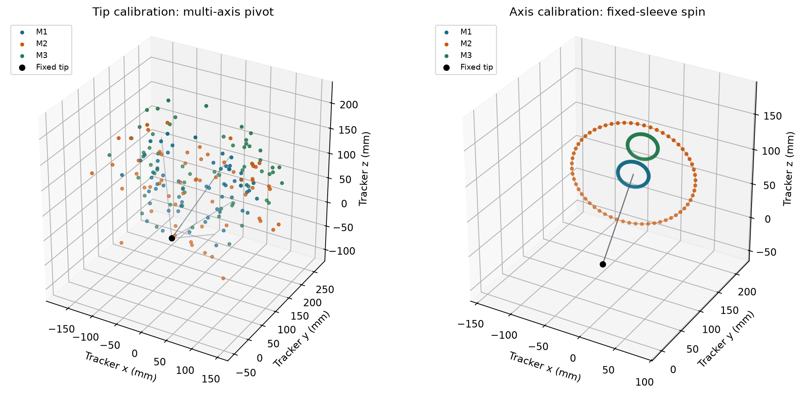
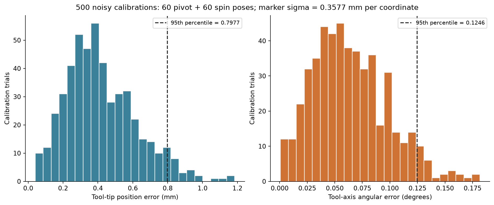

# Q1: Tool calibration

Find the tip position and insertion direction in the tool model frame from
simulated pivot and spin movements. Check exact recovery, then measure the
errors after adding the specified marker noise.

[Project overview and units](../README.md) | [Full verification](../verification/README.md)

## Run this question

From the repository root:

```bash
python -m q1_tool_calibration.run
```

The runner compares the computed answers with the predictions below, then runs
this question's unit tests. It saves the console output and test details in
`outputs/`. The saved output comes from an actual run.

## File guide

| File | Purpose |
| --- | --- |
| [README.md](README.md) | Method, hand calculations, computed results, and interpretation |
| [calibration.py](calibration.py) | Pivot and spin calibration solvers; uses Q2's registration |
| [motions.py](motions.py) | Constrained pivot and spin observations |
| [run.py](run.py) | Hand examples, exact calibration, 500 noisy trials, and integration check |
| [test_calibration.py](test_calibration.py) | 22 tests for calibration, motions, noise, and geometry |
| [plot_results.py](plot_results.py) | Optional figures from the same simulated motions and recorded trials |
| [outputs/calibration-results.json](outputs/calibration-results.json) | Settings, exact results, hand checks, and all 500 noisy error pairs |
| [outputs/calibration_motions.png](outputs/calibration_motions.png) | Pivot and spin movement illustration |
| [outputs/calibration_errors.png](outputs/calibration_errors.png) | Recorded tip and axis error histograms |
| [outputs/run_log.txt](outputs/run_log.txt) | Expected and computed values printed by the runner |
| [outputs/test_report.txt](outputs/test_report.txt) | Individual unit-test names and pass/fail results |
| `__init__.py` | Makes the folder importable and discoverable by unittest |

To regenerate the optional calibration figures:

```bash
python -m pip install -r requirements-plots.txt
python -m q1_tool_calibration.run --plot-dir q1_tool_calibration/outputs
```

The default experiment uses 500 trials, 60 poses per movement, and noise seed
2026. Options `--trials`, `--poses`, `--seed`, and `--output` allow other runs.
Changing those settings changes the saved results; the tables below describe
the default experiment.

## Tool-tip calibration

### Why pivoting works

The tip is held in a fixed dimple while the handle is tilted in different
directions. The markers move, but the tip stays at the same tracker-space
position. This gives a useful constraint without needing the tracker to see
the tip directly.

Let `p` be the unknown tip in the model frame and `q` the unknown fixed pivot
in the tracker frame. Registration gives a rotation and translation for each
observed pose. Therefore every pose should satisfy

```text
R_i p + t_i = q
[R_i  -I] [p; q] = -t_i.
```

There are six unknown coordinates: three in `p` and three in `q`. The code
stacks these equations and solves them using least squares. With noisy
measurements the equations do not agree exactly, so least squares finds the
solution with the smallest sum of squared residuals.

The orientations must vary about more than one axis. Repeating the same pose
adds no new geometric information. Only spinning around the shaft also leaves
an ambiguity along the shaft. The code checks that the stacked system has rank
six. Its condition number indicates how sensitive the solution is to small
changes in the observations.

### A small pivot example worked out by hand

The assignment's true tip is zero, so an extra nonzero-tip example is useful:
it checks that the method actually solves for the tip instead of always
returning `(0,0,0)`.

For this test only, choose the true model-frame tip as `p=(1,2,3)` mm and the
fixed tracker pivot as `q=(10,20,30)` mm. Use the original model markers and
four simple rotations. From `t=q-Rp`, the translations must be:

| Pose | Coordinate rule for R | R p | t = q - R p (mm) |
| --- | --- | --- | --- |
| Identity | (x,y,z) | (1,2,3) | (9,18,27) |
| +90 degrees about x | (x,-z,y) | (1,-3,2) | (9,23,28) |
| +90 degrees about y | (z,y,-x) | (3,2,-1) | (7,18,31) |
| +90 degrees about z | (-y,x,z) | (-2,1,3) | (12,19,27) |

These choices determine the tracker marker positions directly. For example,
in the x-rotation pose, M1 becomes `(20,0,180)+(9,23,28)=(29,23,208)` mm.

| Pose | Observed M1 (mm) | Observed M2 (mm) | Observed M3 (mm) |
| --- | --- | --- | --- |
| Identity | (29,198,27) | (89,198,27) | (29,258,27) |
| x rotation | (29,23,208) | (89,23,208) | (29,23,268) |
| y rotation | (7,198,11) | (7,198,-49) | (7,258,11) |
| z rotation | (-168,39,27) | (-168,99,27) | (-228,39,27) |

The solver receives these marker positions, not the chosen `p` and `q`.
The answer can also be recovered by comparing the equations by hand. For
the identity and x-rotation poses:

```text
Identity: q = (p_x+9,  p_y+18,  p_z+27)
x pose:   q = (p_x+9, -p_z+23,  p_y+28)

Matching y coordinates: p_y + p_z = 5
Matching z coordinates: p_z - p_y = 1
Therefore p_y = 2 and p_z = 3.
```

The y-rotation pose gives `q_x=p_z+7`. Comparing this with
`q_x=p_x+9` gives `p_x=p_z-2=1`. Substitution then gives
`q=(1+9,2+18,3+27)=(10,20,30)` mm. The fourth pose is another check:
`(-2,1,3)+(12,19,27)=(10,20,30)` mm.

**Program result:** the tip is `(1.000000,2.000000,3.000000)` mm and the
pivot is `(10.000000,20.000000,30.000000)` mm to six decimal places. The tip
difference is **6.877e-14 mm**. This agrees with the hand solution to numerical
precision. This example is printed by `q1_tool_calibration.run`.

## Tool-axis calibration

### Why spinning works

The shaft is placed in a stationary guide sleeve and spun without tilting or
sliding along the sleeve. Each off-axis marker then traces a circle. The plane
of that circle is perpendicular to the shaft, so its normal gives the shaft's
axis line.

For each marker, the code subtracts the mean of its observed positions and
fits a plane with SVD. The direction with the least variation is the plane
normal. Normal signs are aligned before averaging, because `n` and `-n`
describe the same plane. Wider circles receive more weight, using the sum of
the two in-plane squared singular values. Their larger spread makes their
normal less sensitive to the same size of marker error.

The combined normal is in the tracker frame. It is rotated back with `R_i.T`
for each observed pose, then averaged and normalized in the model frame.
No translation is applied to this direction.

There is still a sign choice. In this tool, the markers are behind the tip,
so the insertion direction should point from the marker cluster toward the
calibrated tip. This uses the tip found by pivoting, not the known true axis.
This sign rule would need changing for a tool whose markers were beyond the
tip or at the same axial level.

### A spin example worked out by hand

Take four quarter-turn poses about the y axis with the tip at the origin.
The marker coordinates are:

| Rotation about y | M1 (mm) | M2 (mm) | M3 (mm) |
| --- | --- | --- | --- |
| 0 degrees | (20,180,0) | (80,180,0) | (20,240,0) |
| 90 degrees | (0,180,-20) | (0,180,-80) | (0,240,-20) |
| 180 degrees | (-20,180,0) | (-80,180,0) | (-20,240,0) |
| 270 degrees | (0,180,20) | (0,180,80) | (0,240,20) |

For M1, y always equals 180, so all four observations lie in the plane
`y=180`. Their distances from `(0,180,0)` are all 20 mm. M2 also lies in
`y=180`, with radius 80 mm. M3 lies in `y=240`, with radius 20 mm.
All three planes have normals parallel to the y axis.

For a direct normal calculation, subtract M1's first position from its next
two positions. The vectors are `(-20,0,-20)` and `(-40,0,0)`. Their cross
product is `(0,800,0)`, which normalizes to `(0,1,0)`.

The mean model marker position is `(40,200,0)` mm. The vector from there to
the calibrated tip is approximately `(-40,-200,0)`. Its dot product with
`(0,1,0)` is -200, so the normal points away from insertion and must be
reversed. The expected insertion direction is **(0,-1,0)**.

**Program result:** `(-1.401e-16,-1,0)`, giving an angular difference of
**8.029e-15 degrees**. The tiny x component is roundoff. The recovered axis
therefore agrees with the plane geometry and the required insertion sign.

## Exact and noisy calibration experiments

### Motion generation and settings

The larger experiment uses the assignment model with 60 pivot poses and 60
spin poses. Pivot tilts are sampled within a cone with a 40-degree half-angle,
with different azimuths and shaft rolls. The cone allows an 80-degree total
angular span; it does not mean every random sample reaches its boundary.
Spin poses cover a complete turn without repeating the initial pose.

The tracker frame is rotated by 0.4 radians about `(1,2,3)` and the fixed tip
is at `(25,-10,40)` mm. This checks a case where the tracker and model frames
are different. For each chosen rotation, the simulator uses

```text
t_i = fixed_tip_tracker - R_i @ true_tip_model
observed_marker = R_i @ model_marker + t_i.
```

The known tip and axis are used to create these motions and to measure errors
afterward. The calibration solver receives only the model markers and observed
marker arrays. It does not receive the true poses, tip, or axis.

| Setting | Value and reason |
| --- | --- |
| Figure 2 position scale | 10 mm per cm, from the professor's clarification |
| Pivot poses | 60, to use many different orientations |
| Pivot cone half-angle | 40 degrees, to obtain a broad range of tilts |
| Spin poses and arc | 60 poses over 360 degrees, to cover the marker circles |
| Motion seed | 17, so the same motions can be reproduced |
| Noisy calibration trials | 500, to show a distribution rather than one lucky result |
| Noise seed | 2026, so the recorded noisy results can be reproduced |
| Tracker tip position and rotation | Chosen test coordinates, not patient measurements |

The pose count, cone angle, trial count, and seeds are experimental choices.
They are not limits specified by the assignment, and this experiment does not
claim they are optimal.



The left plot shows the markers spreading out as the tool pivots around the
black tip point. The right plot shows the three circles during a fixed-axis
spin. These different patterns are the reason the two movements provide
different calibration information.

### Choosing the noise level

The assignment specifies a 95% probability that a marker's **3D position
error** is below 1 mm. Each coordinate error is independently Gaussian with
mean zero and standard deviation `sigma`. Consequently,

```text
(e_x^2 + e_y^2 + e_z^2) / sigma^2 follows chi-square with 3 degrees of freedom.
The 95th percentile of that distribution is 7.814727903.
1^2 / sigma^2 = 7.814727903
sigma = 1 / sqrt(7.814727903) = 0.357719874 mm per coordinate.
```

The noise utility obtains the same value by numerically inverting the 3D
radial probability function. Using a one-dimensional 1.96 rule would answer
a different question. Errors are not clipped at 1 mm: about 5% should exceed
that radius under the required Gaussian model.

Fresh independent noise is added to every marker coordinate in every pose,
and the pivot and spin sequences use separate draws. Registration is repeated
on those noisy observations before calibration is solved again. Adding noise
only to the final tip would skip the propagation through registration.

### Exact-data result

The expected tip is `(0,0,0)` mm and the expected axis is `(0,-1,0)`.

| Quantity | Computed result | Difference from expected |
| --- | --- | --- |
| Tip (mm) | (2.163e-14, -7.105e-15, -7.360e-16) | 2.278e-14 mm |
| Axis | (5.327e-18, -1, -2.478e-17) | 1.452e-15 degrees |

These differences are at the level of floating-point roundoff. They show that
the geometric calculation recovers the simulated truth without noise. They
do not represent the accuracy of a real tracking system.

### Noisy result and how the errors are calculated

In the first noisy trial, the estimated tip is
`(0.09751964,0.11974373,-0.02350761)` mm. Since the true tip is zero, its
position error is

```text
sqrt(0.09751964^2 + 0.11974373^2 + (-0.02350761)^2) = 0.156209 mm.
```

The estimated unit axis is approximately
`(0.0000628276,-0.9999992775,-0.0012004288)`. Its angle from `(0,-1,0)` is
**0.068874 degrees**. The implementation uses
`atan2(norm(cross(estimated,true)), dot(estimated,true))` to measure this angle
accurately near zero. A backwards axis would give 180 degrees, not zero.

Across all 500 trials, the results are:

| Error magnitude | Mean | Median | RMS | 95th percentile | Maximum |
| --- | ---: | ---: | ---: | ---: | ---: |
| Tip position (mm) | 0.419917 | 0.390112 | 0.465978 | 0.797692 | 1.184480 |
| Axis direction (degrees) | 0.064259 | 0.059526 | 0.072717 | 0.124624 | 0.181567 |

Mean is the average error magnitude. RMS gives larger errors more weight
because they are squared first. The 95th percentile describes the upper part
of the observed distribution; it is not a confidence interval or a guaranteed
limit. All 500 error pairs are included in the JSON results.

There are `500 * (60+60) * 3 = 180,000` noisy marker observations. Of these,
**95.0439%** have error below 1 mm. The expected standard error of this
fraction is `sqrt(0.95*0.05/180000)`, or about **0.0514 percentage points**.
The observed fraction is therefore consistent with the intended 95% bound.



Most tip errors in this run are below about 0.8 mm, while the axis errors are
mostly below about 0.125 degrees. A few larger errors occur. This is expected
for an unbounded Gaussian noise model. A 1 mm marker-error probability bound
does not impose a 1 mm maximum on the calibrated tip error.

The tip is about 180-240 mm from the markers. Small errors in a recovered pose
can therefore produce larger displacement at the tip than at the markers.
Using many poses reduces random fluctuations, but it does not eliminate them.
The first noisy trial has a pivot residual of about **2.231634 mm** and a
tip-estimate error of **0.156209 mm**. These are different quantities: the
residual measures scatter among reconstructed pivot positions, while the tip
error compares the final estimate with the known truth.

### Motion-quality checks

Rank-deficient pivot systems are rejected. For spinning, the code ignores
unresolved marker planes and checks whether the remaining normals and
transformed directions agree. It uses a smallest-to-middle singular-value
ratio of 0.25 and a 10-degree agreement threshold as coarse sanity checks.
These are implementation choices for rejecting clearly unsuitable data, not
accuracy limits supplied by the assignment. They have not been established
as clinical acceptance thresholds. Small residuals alone cannot prove that
the physical motion constraints were followed correctly.

## Validation and limits

All 22 tests in [test_calibration.py](test_calibration.py) passed. They include
a nonzero tip, an oblique model axis, unsuitable motions, and the noise model.
The two printed hand examples are additional demonstrations, not extra tests
in that count. Full-precision values are saved in
[the JSON results](outputs/calibration-results.json).

The final runner check feeds the exact calibrated tip and axis through Q2 and
Q3. Its expected `(error, entry, core, depth)` is `(3,96,8,104)` mm; the hand
derivation is in [Q3](../q3_biopsy_plan/README.md#checking-the-complete-calculation).
The noisy calibration results do not establish the separate Q4 targeting limit.
See the [shared limitations and references](../README.md#limitations).
