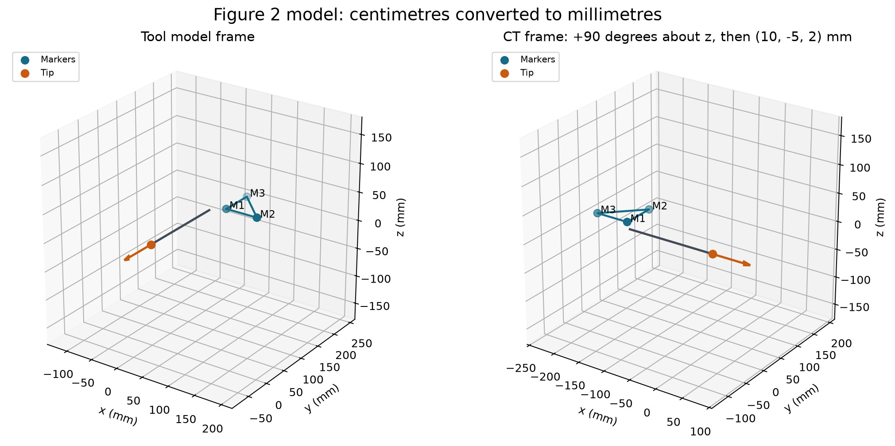

# Q2: Registration to the CT frame

Recover the rigid pose from corresponding model and CT markers, then
transform the calibrated tip and direction into CT coordinates.

[Project overview and units](../README.md) | [Full verification](../verification/README.md)

## Run this question

From the repository root:

```bash
python -m q2_registration.run
```

The runner compares the computed answers with the predictions below, then runs
this question's unit tests. It saves the console output and test details in
`outputs/`. The saved output comes from an actual run.

## File guide

| File | Purpose |
| --- | --- |
| [README.md](README.md) | Method, hand calculations, computed results, and interpretation |
| [registration.py](registration.py) | Rigid registration and transformation of the tip and axis |
| [cases.py](cases.py) | Literal marker inputs and hand-predicted answers for the three cases |
| [run.py](run.py) | Prints and checks the three required transformations |
| [test_registration.py](test_registration.py) | 12 tests for transforms, reflections, and invalid marker layouts |
| [outputs/registration_frames.png](outputs/registration_frames.png) | Model and CT poses in the combined example |
| [outputs/run_log.txt](outputs/run_log.txt) | Expected and computed values printed by the runner |
| [outputs/test_report.txt](outputs/test_report.txt) | Individual unit-test names and pass/fail results |
| `__init__.py` | Makes the folder importable and discoverable by unittest |

## Method

Registration uses the three corresponding model and CT markers to find a
rotation and translation. Subtracting each set's centroid removes translation
from the rotation problem. For centered row arrays `X` and `Y`, the code forms
`H=X.T @ Y` and computes its SVD, `H=U S V.T`.

The rotation is `R=V D U.T`, where the last diagonal entry of `D` is chosen
so that `det(R)=+1`. This prevents returning a mirror reflection. Translation
then follows from `t=mean(CT markers)-R @ mean(model markers)`.

Three noncollinear markers define a rigid pose. Their centered points have
rank two because three points lie in a plane; rank three is not required.
Collinear markers leave a rotation around their line unresolved and are
rejected. With noisy markers, the fitted pose minimizes squared marker
residuals. It does not try to resize the tool.

## Three required predictions

Use translation `t=(10,-5,2)` mm. For rotation, use +90 degrees about z:

```text
R = [0 -1 0]
    [1  0 0]
    [0  0 1]

R(x,y,z) = (-y,x,z).
```

**Translation only.** Add `(10,-5,2)` to each position. For M1,
`(20,180,0)+(10,-5,2)=(30,175,2)` mm. The tip becomes `(10,-5,2)` mm.
The direction stays `(0,-1,0)` because translation does not rotate the tool.

**Rotation only.** M1 becomes `(-180,20,0)` mm, and the tip at the origin
stays at the origin. Applying the same rotation to `(0,-1,0)` gives
`(1,0,0)`, so the needle now points along positive x.

**Rotation followed by translation.** M1 becomes
`(-180,20,0)+(10,-5,2)=(-170,15,2)` mm. The tip is `(10,-5,2)` mm and
the direction is still `(1,0,0)`.

Applying these same rules to all markers gives the actual test inputs:

| Case | M1 in CT (mm) | M2 in CT (mm) | M3 in CT (mm) |
| --- | --- | --- | --- |
| Translation | (30,175,2) | (90,175,2) | (30,235,2) |
| Rotation | (-180,20,0) | (-180,80,0) | (-240,20,0) |
| Both | (-170,15,2) | (-170,75,2) | (-230,15,2) |

As another check for the combined case, the model centroid is `(40,200,0)`
and the CT centroid is `(-190,35,2)`. The rotated model centroid is
`(-200,40,0)`, so the translation recovered from the centroids is
`(-190,35,2)-(-200,40,0)=(10,-5,2)` mm.

## Computed registration results

| Case | Expected tip (mm) | Computed tip, rounded (mm) | Expected / computed axis, rounded | Tip difference (mm) |
| --- | --- | --- | --- | ---: |
| Translation | (10,-5,2) | (10,-5,2) | (0,-1,0) / (0,-1,0) | 7.653e-14 |
| Rotation | (0,0,0) | (0,0,0) | (1,0,0) / (1,0,0) | 6.071e-14 |
| Both | (10,-5,2) | (10,-5,2) | (1,0,0) / (1,0,0) | 6.071e-14 |

The corresponding axis-vector differences are `2.782e-16`, `1.564e-16`,
and `1.564e-16`. These are numerical roundoff, not changes in the expected
direction. The tests compare unrounded values with tolerance `1e-12`.
This tolerance is for exact synthetic cases, not for accepting noisy patient data.



The figure shows the same triangle and shaft before and after the combined
transformation. The distances between the markers stay the same; only the
position and orientation change. The tests also transform a nonzero tip,
so successful results do not depend on the tip being at the model origin.

## Validation and connection to the other questions

All 12 registration tests passed; the names and results are in
[test_report.txt](outputs/test_report.txt). Q1 also uses this registration
function to recover every observed calibration pose. Q3 uses the recovered
tip and axis as its planning inputs.

These isolated Q2 examples use the known model tip and axis so that the
registration calculation can be checked independently. In the full pipeline,
pass Q1's calibrated values instead. The
[combined check in Q3](../q3_biopsy_plan/README.md#checking-the-complete-calculation)
and [integration tests](../verification/test_integration.py) check that connection.
See the [shared limitations and references](../README.md#limitations).
