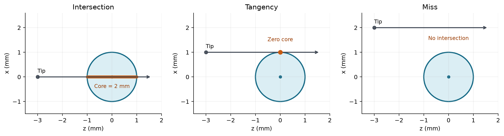

# Q3: Biopsy planning

Use the current CT-frame tip and direction to calculate targeting error,
available tissue-core length, and insertion depth for a spherical tumor.

[Project overview and units](../README.md) | [Full verification](../verification/README.md)

## Run this question

From the repository root:

```bash
python -m q3_biopsy_plan.run
```

The runner compares the computed answers with the predictions below, then runs
this question's unit tests. It saves the console output and test details in
`outputs/`. The saved output comes from an actual run.

## File guide

| File | Purpose |
| --- | --- |
| [README.md](README.md) | Method, hand calculations, computed results, and interpretation |
| [transcript.md](transcript.md) | Student/Chatbot discussion of targeting distance and forward biopsy planning |
| [planning.py](planning.py) | Point-to-axis distance, sphere intersections, and forward insertion |
| [run.py](run.py) | Three path cases, combined Q2/Q3 calculation, and Figure 6 distance check |
| [test_planning.py](test_planning.py) | 26 tests for planning geometry, boundary cases, and invalid inputs |
| [outputs/biopsy_trajectories.png](outputs/biopsy_trajectories.png) | Intersecting, tangent, and missing trajectories |
| [outputs/run_log.txt](outputs/run_log.txt) | Expected and computed values printed by the runner |
| [outputs/test_report.txt](outputs/test_report.txt) | Individual unit-test names and pass/fail results |
| `__init__.py` | Makes the folder importable and discoverable by unittest |

## Geometry and definitions

Let `P` be the current tip, `u` the unit insertion direction, `C` the tumor
center, and `r` its radius. The line through the needle is `P+s*u`.
Normalizing `u` makes `s` a distance in mm.

Set `w=C-P`. The distance along the axis to the closest point is
`a=dot(w,u)`. The shortest distance from the center to the axis is
`d=norm(w-a*u)`, equivalently `norm(cross(w,u))`. This `d` is the targeting
error shown by the perpendicular segment in assignment Figure 6.

If `d<=r`, a right triangle gives the half-chord length
`h=sqrt(r^2-d^2)`. The near and far intersection distances are `a-h` and
`a+h`. When both intersections lie ahead of an outside tip, the available
core is `2h` and insertion depth is `a+h`.

The depth reaches the far tumor boundary because reaching the near boundary
only starts the tissue sample. Stopping at the center would not traverse the
full available core. This calculation treats the core as a line segment;
it does not model a particular cutting mechanism.

## Three required cases worked out by hand

Choose `C=(0,0,0)`, `r=1` mm, and `u=(0,0,1)`. This unit sphere makes the
expected results simple. Its 1 mm radius is a chosen mathematical test size,
not a claim about the tumor in the clinical image.

**Intersection: P=(0,0,-3).** The path is `(0,0,-3+s)`. It passes through the
center, so `d=0`. Substituting into the sphere equation gives
`(-3+s)^2=1`, hence `s=2` and `s=4`. The core length is `4-2=2` mm and
the full insertion depth is 4 mm.

**Tangency: P=(1,0,-3).** The path is `(1,0,-3+s)`, so its perpendicular
distance from the center is 1 mm. The sphere equation becomes
`1+(-3+s)^2=1`, giving the repeated intersection `s=3`. Entry and exit are
the same point, so core length is zero. The 3 mm value is a contact depth,
not a successful tissue sample.

**Miss: P=(2,0,-3).** The path is `(2,0,-3+s)`, with `d=2` mm. The sphere
equation would require `4+(-3+s)^2=1`, or a square equal to -3. There is no
real intersection. Core length is zero and insertion depth is `None` because
there is no distance that reaches this sphere along the current direction.

| Case | Expected error / core / depth (mm) | Computed error / core / depth (mm) | Meaning |
| --- | --- | --- | --- |
| Intersection | 0 / 2 / 4 | 0.0 / 2.0 / 4.0 | A 2 mm line segment passes through the sphere |
| Tangency | 1 / 0 / 3 | 1.0 / 0.0 / 3.0 | One contact point, no tissue-core length |
| Miss | 2 / 0 / None | 2.0 / 0.0 / None | The needle axis does not reach the sphere |



The plots match these predictions: the center path crosses the whole diameter,
the tangent touches one point, and the offset path stays outside. The numeric
comparison is still necessary; a plot alone would not check the insertion depth.

## Forward insertion and edge cases

Targeting error uses the infinite axis, but insertion only moves forward from
the current tip. These are different geometric objects.

| Extra case, with C=(0,0,0) and r=1 | Expected behavior and reason |
| --- | --- |
| P=(0,0,3), u=(0,0,1) | Axis error is zero, but intersections are at s=-4 and -2. The sphere is behind the tip, so core=0 and depth=None. |
| P=(0,0,0), u=(0,0,1) | The tip is inside. Only the segment from s=0 to 1 remains ahead, so core=1 mm and depth=1 mm. |
| P=(0,0,1), u=(0,0,1) | The tip starts on the surface and points outward. No forward tissue remains, so core=0 and depth=0. |
| P=(0,0,-3), direction=(0,0,10) | Normalizing the direction must still give core=2 mm and depth=4 mm. |

The planning tests check these cases, reversed directions, near tangency, and
invalid inputs. The code uses a small scale-dependent floating-point tolerance
near tangency. It is intended to absorb roundoff, not to make a genuine miss
count as a hit.

## Checking the meaning of Figure 6

Suppose the planned target is `(0,-100,0)` mm, the actual tip is `(3,0,0)` mm,
and the axis is `(0,-1,0)`. Move the target to `(0,-104,0)` mm. The actual
needle line is `(3,-s,0)`. Its closest point to the displaced target is
`(3,-104,0)`, so the targeting error is **3 mm**.

After exactly 100 mm of insertion, the endpoint would instead be
`(3,-100,0)`. Its distance to the displaced target is
`sqrt(3^2+4^2)=5` mm. The program returns 3 mm for the Figure 6 metric and
prints 5 mm only for comparison. This example explains why the two distance
definitions cannot be substituted for each other.

## Checking the complete calculation

For the combined registration example, the tool tip is `(10,-5,2)` mm and
the axis is `(1,0,0)`. Choose tumor center `(110,-2,2)` mm and radius 5 mm.
The center relative to the tip is `(100,3,0)` mm. Therefore:

```text
Distance along the axis: a = 100 mm
Perpendicular error:    d = sqrt(3^2+0^2) = 3 mm
Half chord:            h = sqrt(5^2-3^2) = 4 mm
Entry depth:           a-h = 96 mm
Core length:           2h = 8 mm
Insertion depth:       a+h = 104 mm.
```

| Output | Hand expectation (mm) | Computed value (mm) |
| --- | ---: | ---: |
| Targeting error | 3 | 3.000000000000037 |
| Entry depth | 96 | 96.00000000000009 |
| Core length | 8 | 7.999999999999943 |
| Insertion depth | 104 | 104.00000000000003 |

The small differences are roundoff. This case is more useful than another
center hit because it checks the nonzero offset and the chord calculation.

The calibration example also runs this case using the **estimated tip and
axis from exact calibration**, rather than directly using the model's true
values. Its result agrees with the same `(3,96,8,104)` mm prediction within
`1e-9`. This checks that the outputs of calibration can be used by registration
and planning without a frame or unit mismatch.

## Validation and limits

All 26 planning tests passed. The [run log](outputs/run_log.txt) records each
hand prediction beside its computed value, including the complete calculation
above. The [test report](outputs/test_report.txt) records the extra edge cases.
The three cross-question checks are in
[verification/test_integration.py](../verification/test_integration.py).

The Figure 6 example here checks the definition of targeting error. It does
not carry out Q4's random target-displacement experiment. That question is
left for the teammate responsible for it. See the
[shared limitations and references](../README.md#limitations).
